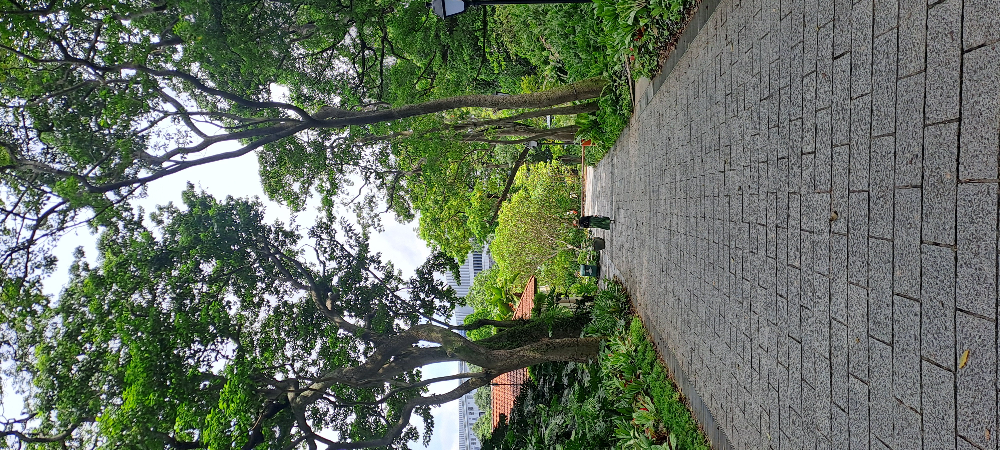
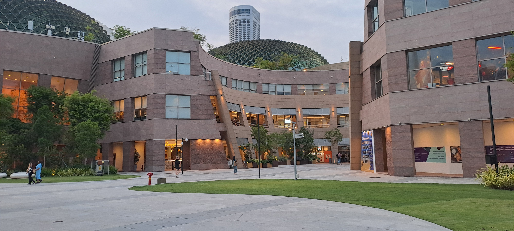
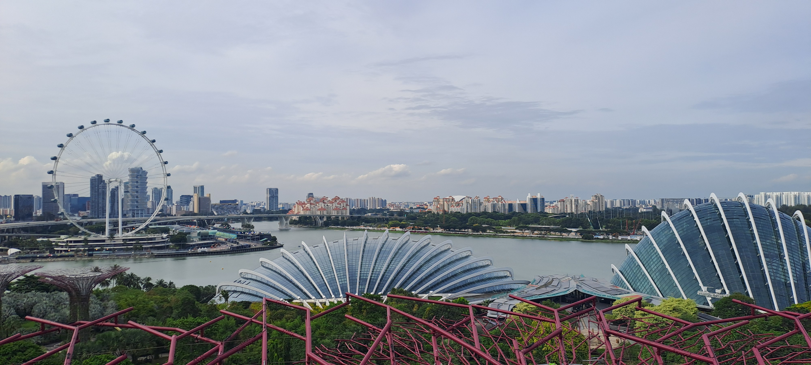
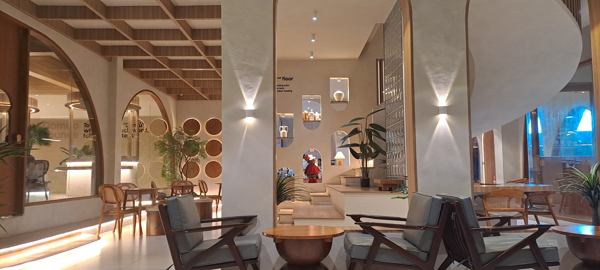
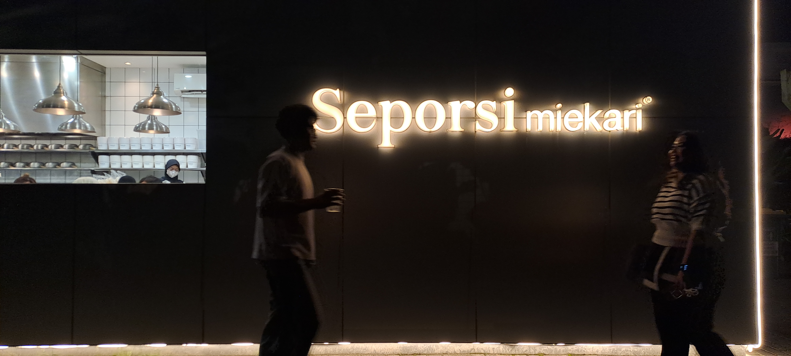

# Hi, I'm Ditha 👋

### Assistant to VP | Business Operations | R&D | AI & Project Management

Welcome to my professional portfolio!

I am a business and operations professional with experience in fulfillment coordination, customer service, research and development, and international business partnerships.

I am passionate about using AI, technology, and project management to improve workflows, solve business problems, and support data-driven decisions.

## 💼 Professional Background

- Business Operations & Fulfillment
- Research & Development
- Executive Assistance & Business Coordination
- International Customer Service
- Process Improvement & Project Management

## 🚀 Areas of Interest

- 🤖 Artificial Intelligence & Prompt Engineering
- ⚙️ Workflow Automation & Business Process Optimization
- 📊 Data Analytics & Business Intelligence
- 📋 Project Management
- 🌏 International Relations, Security & Migration Research

## 🛠️ Skills & Learning

- Project Management: Agile, Waterfall, SMART, and OKRs
- Technology: IT Support and AI-assisted workflows
- Business: Operations, Customer Service, R&D, and Coordination
- Languages: English (C1); conversational Chinese and Korean

## 🎓 English Proficiency

**Certification:** EF SET English Certificate  
**CEFR Level:** C2

🔗 [View My Verified EF SET Certificate](https://cert.efset.org/cGRuAk?trk=public_profile_see-credential)

## 📚 Certifications & Training

- Google Project Management
- Google IT Support
- IBM IT Support
- Additional training in Agile, SDLC, and process management

## 🎯 Current Portfolio Goals

I am developing practical projects focused on:

- AI-powered Customer Service Workflows
- Order Fulfillment Tracking
- AI-Assisted Project Management
- Business Operations Dashboards
- International Security & Migration Research

More projects and case studies will be added as I continue learning and building.

## 🌱 My Mission

To combine business experience, technology, AI, and international perspectives to create practical solutions and continuous improvement.

## 📫 Connect With Me

- GitHub: [Github](https://github.com/dithalee16)
- LinkedIn: [LinkedIn](https://id.linkedin.com/in/ditha-lee-9305a2a9)

*Learning continuously. Building practically. Improving every day.*

## 🎧 Find Me on Spotify

Explore my music and discover my releases on Spotify.

## 📸 Photo Portfolio

These photos were taken by using Android Phone without any additional editing.

  
  
  

  
  
  

  
  
  

